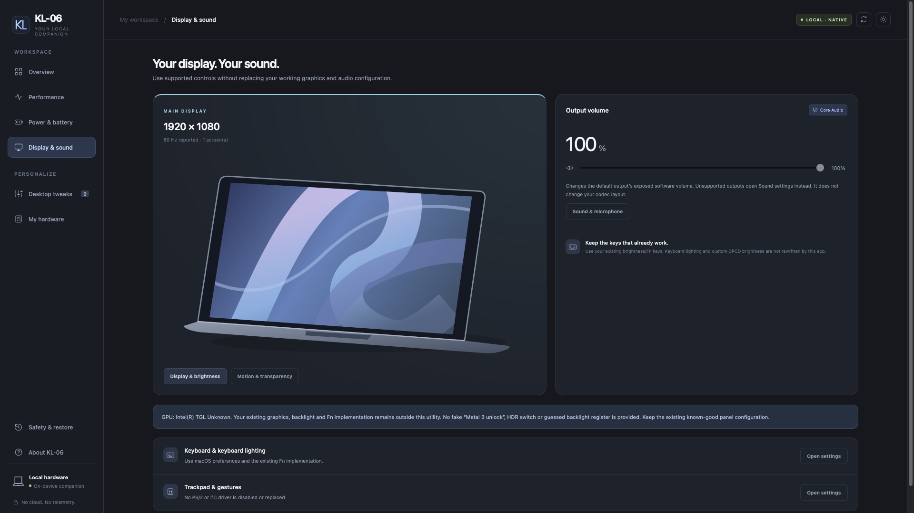
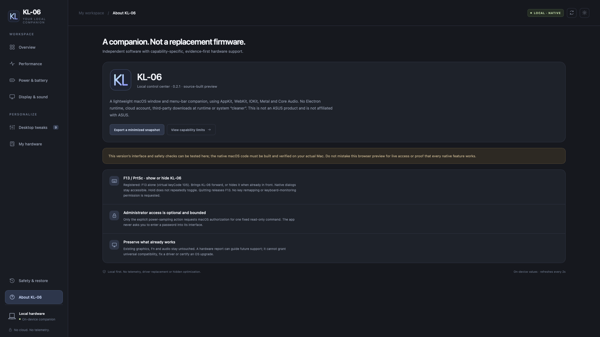

<div align="center">

# ⚡ KL-06 Manager

### *Next-Generation Control Center for Modern Hackintosh Systems*

[](https://github.com/Kaushal-snap/KL-06-Manager/releases/tag/v0.3.0-beta.1)
[-059669?style=for-the-badge&logo=checkmarx&logoColor=white)](https://github.com/Kaushal-snap/KL-06-Manager/releases)
[-7C3AED?style=for-the-badge&logo=apple&logoColor=white)](https://github.com/Kaushal-snap/KL-06-Manager)
[](https://github.com/Kaushal-snap/KL-06-Manager)
[-0284C7?style=for-the-badge&logo=intel&logoColor=white)](https://github.com/Kaushal-snap/KL-06-Manager)
[-0891B2?style=for-the-badge&logo=intel&logoColor=white)](https://github.com/Kaushal-snap/KL-06-Manager)
[](https://github.com/Kaushal-snap/KL-06-Manager)
[](https://github.com/Kaushal-snap/KL-06-Manager)

<br/>

<p align="center">
  <b>A lightweight, beautiful, and capability-aware macOS control companion.</b><br/>
  <i>Engineered specifically for Tiger Lake-U (Intel Core i5-1135G7) & Intel Iris Xe Graphics.</i><br/>
  Zero external telemetry • Read-only sensor verification • Atomic preference rollback
</p>

<p align="center">
  <a href="https://github.com/Kaushal-snap/KL-06-Manager/releases/tag/v0.3.0-beta.1"></a>
  <a href="CHANGELOG.md"></a>
  <a href="ARCHITECTURE.md"></a>
  <a href="HARDWARE-REPORTS.md"></a>
</p>

---

</div>

<br/>

## 🎯 Target Hardware & Verified Baseline

KL-06 Manager is built and verified on physical hardware running **macOS Sequoia 15.8.3** (Build `24H241`, Darwin Kernel `24.6.0`, `x86_64`):

| Subsystem | Target Observation | Status Badge | Verified Safety Policy |
| :--- | :--- | :---: | :--- |
| **Graphics** | Intel Iris Xe Graphics (`0x9a49`), Metal 2, 1536 MB Dynamic VRAM |  | Custom WhateverXe 0.8.2 binary preserved (`9e18e609...`). No driver overwrite. |
| **Display** | 1920×1080 @ 60 Hz, 30-Bit Color Depth (ARGB2101010) |  | OLED / DPCD brightness & DSDT + SSDT-ASUS-FN intact. **HDR OFF** baseline strictly preserved. |
| **Global Hotkey** | Physical `PrtSc` mapped to virtual **F13** (`keyCode 105`) |  | Show/Hide window toggle while running. Carbon `buffer.count` (`Int`) fix verified. |
| **Core Audio** | Built-in 44.1 kHz in / 96 kHz out (layout-id 7 / alc-layout-id 48) |  | Master output volume slider supported. Speakers, mic, & jack switching preserved. |
| **Desktop Tweaks**| 9 Reversible Dock, Finder, and Appearance settings |  | Atomic restore journal (`~/Library/Application Support/KL-Asus/Restore-v1.plist`). |
| **CPU Telemetry** | 11th Gen Intel Core i5-1135G7 @ 2.40 GHz (8 logical cores) |  | Real dynamic load & memory counters. No fake overclocking or CPUFriend tampering. |
| **Thermals & Fans**| `SMCSuperIO`: 0, `AsusSMC`: 0 (No WMI / EC fan RPM sensor) |  | **Strict Rule:** Fan controls honestly unavailable. No fake sliders or simulated curves. |
| **Battery Health** | Service Recommended, 314 cycles, 2236 / 3549 mAh (~63% ratio)|  | Real ACPI reporting surfaced honestly; no fake software calibration or charge limits. |

<br/>

---

## 📸 Verified On-Device Screenshots

Native execution captured live on target hardware (`LOCAL • NATIVE` state):

<div align="center">

| 1. Overview Dashboard | 2. Performance & Sampling |
| :---: | :---: |
|  |  |

| 3. Display & Sound Controls | 4. About KL-06 & Hotkey Status |
| :---: | :---: |
|  |  |

</div>

<br/>

---

## 🚀 Key Highlights & Capabilities

<div align="left">

### 🎨 MyASUS-Inspired Modern Interface
- **Dark Mode Aesthetic:** Tailored specifically for 1080p OLED panels with rich contrast and low power footprint.
- **Micro-Metric Telemetry:** Real-time CPU utilization, active memory pressure, and Mach kernel task metrics rendered via hardware-accelerated WebKit canvas.
- **Tactile Visual Feedback:** Color-coded status pills indicating live bridge connectivity (`LOCAL • NATIVE`).

### ⌨️ Global Hotkey Toggle (F13)
- Instant show/hide overlay toggle bound to the physical `PrtSc` key mapped as virtual **F13** (`keyCode 105`).
- Low-overhead Carbon application event loop listener with native press/release latching.
- Auto-focus preservation: Prevents activation over system dialogs or active password prompts.

### 🔊 Core Audio & Display Management
- Direct master volume slider manipulating macOS default output device channels without audio degradation.
- Display brightness integration harmonized with Apple DPCD / OLED backlight controllers.
- Preserves paired DSDT and SSDT-ASUS-FN brightness hotkey tables.

### 🛠️ 9 Reversible Desktop Tweaks & Atomic Rollback
Safely tweak system-level cosmetic preferences with automatic atomic rollback journaling:
- **Dock Configuration:** Auto-hide delay, magnification toggle, active app indicators, orientation.
- **Finder Preferences:** Show file extensions, display path bar, toggle hidden files, default search scope.
- **Appearance & Window Behavior:** Animated window minimization and dark menu bar styling.
- *Safety Journal:* Every write persists prior state to `~/Library/Application Support/KL-Asus/Restore-v1.plist` before applying changes.

</div>

<br/>

---

## 🛡️ Security, Privacy & Privilege Invariants

```
┌────────────────────────────────────────────────────────┐
│                   WKWebView UI Layer                   │
│         Bundled Local HTML / CSS / Modern JS           │
└───────────────────────────┬────────────────────────────┘
                            │ Safe JSON Message Allowlist
                            ▼
┌────────────────────────────────────────────────────────┐
│             WKScriptMessageHandler (Native)            │
├────────────────────────────────────────────────────────┤
│  • Read-only Mach task & sysctl queries                │
│  • CoreGraphics & CoreAudio default device API         │
│  • Nine-key CFPreferences registry with write verify   │
│  • Atomic restore journal check before write           │
│  • Bounded powermetrics sampler (user-authorized only) │
└───────────────────────────┬────────────────────────────┘
                            │
                            ▼
┌────────────────────────────────────────────────────────┐
│                   Target macOS Sequoia                 │
│      NO root daemons • NO kexts • NO EFI tampering     │
└────────────────────────────────────────────────────────┘
```

> [!IMPORTANT]
> **Strict Safety Standards:**
> 1. **Zero Network Traffic:** Enforces `connect-src 'none'`. No remote analytics, telemetry reporting, or auto-updaters.
> 2. **User-Space Privileges:** Runs strictly in user space (`UID 501`). No root daemons, background agents, or kernel extensions.
> 3. **Non-Destructive EFI Policy:** Never modifies OpenCore configs, ACPI tables, boot arguments, or WhateverGreen / WhateverXe binaries.
> 4. **No Simulated Controls:** Fan RPM sensors are missing on this hardware (`SMCSuperIO: 0, AsusSMC: 0`); therefore, fan controls are honestly disabled rather than faked with simulated sliders.

<br/>

---

## 📦 Download & Quick Installation (Beta)

> [!TIP]
> Download the pre-built, tested release binary directly from GitHub Releases:

1. **Download:** Grab [**`KL-06.zip`**](https://github.com/Kaushal-snap/KL-06-Manager/releases/tag/v0.3.0-beta.1) from the v0.3.0-beta.1 release (or use the [Google Drive Direct Download Mirror](https://drive.google.com/uc?id=1sewP7SFL_52wkvWgeu9pueWXp_wWmp0f&export=download)).
2. **Extract:** Double-click `KL-06.zip` to extract `KL-06 Manager.app`.
3. **Deploy:** Drag `KL-06 Manager.app` into `/Applications` (or test directly from `Downloads`).
4. **Launch & Toggle:** Open `KL-06 Manager.app` and press **`PrtSc` (F13)** anytime to summon or dismiss the control center.

### 🔐 Cryptographic Checksums & Binary Verification

```bash
# Verify release archive integrity (Clean Release ZIP)
shasum -a 256 KL-06.zip
# Expected: acf8991e078e676509ddcfdc3ddc1ec5503e6802a2749078eef82f19925bec8e

# Verify original intake archive integrity (Owner Build ZIP)
# SHA-256: df8582014df1e405c66125d8c0c7811b88cd6edfedc1bdda3c2c41cc89d6ec7d

# Verify Mach-O binary architecture and checksum
shasum -a 256 /Applications/KL-06\ Manager.app/Contents/MacOS/KL-06
# Expected: 4cb9aecf1cc460ed872d2260a1e9cd833d447585ffde77b4ab5cf152c748c3ba
# Architecture: Mach-O 64-bit executable x86_64
```

<br/>

---

## 🌌 Active Milestone: v0.3.0-beta.1 (Cirrus Theme / Build 4)

Native physical hardware compilation and verification completed on target ASUS VivoBook K15 OLED (K513EA):

| Feature Milestone | Status | Description |
| :--- | :---: | :--- |
| **Cirrus OLED-Dark Theme** |  | High-contrast dark theme with bespoke gradients optimized for OLED panels. |
| **AppleSMC Fan Reader** |  | Auditable read-only C reader querying standard `FNum` and `F0Ac`/`F1Ac` keys. |
| **Honest Fan Reporting** |  | Sensor unavailable state reported honestly on target Hackintosh hardware. |
| **HWiNFO Telemetry Parser** |  | Local Windows CSV importer supporting unpadded-second timestamps. |
| **Native Target Compile** |  | Compiled natively via `UPDATE-KL-06.command` on macOS Sequoia 15.8.3. |

<br/>

---

## 🔒 Proprietary License & Closed-Source Rights

**Copyright © 2026 Kaushal-snap. All Rights Reserved.**

This software is distributed in compiled binary form for testing and validation on verified hardware targets. Unauthorized copying, reverse engineering, redistribution, decompilation, or modification of this application or associated binary assets is strictly prohibited without express written permission.
