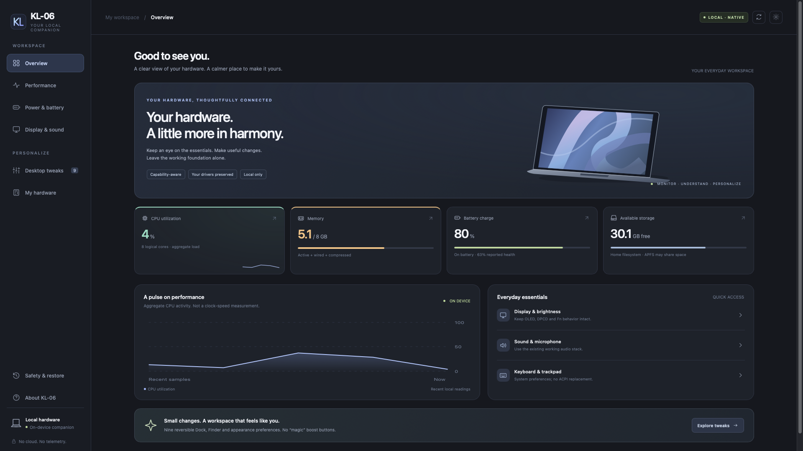

<div align="center">

# ⚡ KL-06 Manager

### *Next-Generation Universal Control Center & AirDrop Hub by Kaushal Labana*

[](https://github.com/Kaushal-snap)
[](mailto:labanayt@gmail.com)
[](https://discord.gg/Z4my8c2ZH)
[](https://youtube.com/@labanayt?si=jWfcVFG23xmSP9WM)
[-2563EB?style=for-the-badge&logo=apple&logoColor=white)](https://github.com/Kaushal-snap/KL-06-Manager/releases)
[](https://github.com/Kaushal-snap/KL-06-Manager/releases)
[-7C3AED?style=for-the-badge&logo=apple&logoColor=white)](https://github.com/Kaushal-snap/KL-06-Manager)
[](https://github.com/Kaushal-snap/KL-06-Manager)
[](https://github.com/Kaushal-snap/KL-06-Manager)

<br/>

> **Platform status (v0.4.7-beta, build 12):** This repository contains platform-specific source, not proof that every platform build or transport has been tested. Current KL-06 transport is private-LAN TLS; Android has a sender path to the desktop broker. Bluetooth and cellular relay are not implemented. iOS/macOS/Windows file-transfer directions are not end-to-end verified. Fan RPM is read-only and remains unavailable when the installed AppleSMC/VirtualSMC provider does not expose supported tachometer keys. Google Drive runtime log upload is not configured.

> **Release mismatch:** The GitHub Releases page has not yet published a matching v0.4.7-beta Build 12 release. The badge above identifies the source snapshot only; do not treat the older GitHub release as the current binary. Native builds and device transfers remain unverified until the workflow and physical-device checks pass.

<p align="center">
  <b>A lightweight, beautiful, and capability-aware universal control companion across Mac, Windows, Android, and iPhone.</b><br/>
  <i>Architected & Developed by <b>Kaushal Labana</b>.</i><br/>
  Zero external telemetry • 6-digit mutual PIN pairing • Auto-pair incoming alert • Read-only sensor verification
</p>

<p align="center">
  <a href="#-device-downloads-matrix-v042-beta-build-9"></a>
  <a href="mailto:labanayt@gmail.com"></a>
  <a href="https://discord.gg/Z4my8c2ZH"></a>
  <a href="https://youtube.com/@labanayt?si=jWfcVFG23xmSP9WM"></a>
  <a href="CHANGELOG.md"></a>
  <a href="ECOSYSTEM.md"></a>
</p>

---

</div>

<br/>

## 🌐 Community & Direct Support

Connect directly with the developer **Kaushal Labana**:
- ✉️ **Official Support Email**: [labanayt@gmail.com](mailto:labanayt@gmail.com)
- 💬 **Discord Community**: [https://discord.gg/Z4my8c2ZH](https://discord.gg/Z4my8c2ZH) (Username: **`labanayt5301`**)
- ▶️ **YouTube Channel**: [https://youtube.com/@labanayt?si=jWfcVFG23xmSP9WM](https://youtube.com/@labanayt?si=jWfcVFG23xmSP9WM) (**`@labanayt`**)
- 🐙 **GitHub Repository**: [https://github.com/Kaushal-snap/KL-06-Manager](https://github.com/Kaushal-snap/KL-06-Manager)

<br/>

## 📱 Device Downloads Matrix (v0.4.7-beta Build 12)

| Platform | Deliverable Package | Compatibility / Min OS | Size | SHA-256 Checksum | Direct Download Mirror |
| :--- | :--- | :---: | :---: | :---: | :---: |
| 🤖 **Android (Zip)** | `KL-06-0.4.7-beta-android-debug-UNTESTED.zip` | **Android 8.0+** (API 26 to Android 17+) | 1.08 MB | `ea33a75776d954a7707f909b6e896720dfef3fb273a23b2bde3cc269fb81d060` | [Direct Download (Drive)](https://drive.google.com/uc?id=1CivkD7fE-cYzsB3QoR-_U_Ch3-X_8Phe&export=download) |
| 🤖 **Android (APK)** | `KL-06-Manager.apk` | **Android 8.0+** (Dual v1+v2 Signed) | 1.12 MB | `a7cda1e545bb8c3c3887911c67d929d3333e130fedc9edd37f94bd205c6a56e6` | [Direct APK (Drive)](https://drive.google.com/uc?id=1IqEQJneefBF9iXS8Zy8HI2DeTe6kAzMP&export=download) |
| 🍎 **macOS** | `KL-06 Manager 0.4.7.zip` | **macOS 13.0+** (Ventura, Sonoma, Sequoia) | 215 KB | `d8783b07bf73165770439ceca71f8017f0a899a4b437ef64f09ca2eb25320748` | [Direct Download (Drive)](https://drive.google.com/uc?id=1fW9rrtgdcmDmAB2KYtYcuPiPCA6wR8-E&export=download) |
| 🪟 **Windows** | `KL-06-0.4.7-beta-windows-x64-UNTESTED.zip` | **Windows 7 SP1+** (7, 8, 8.1, 10, 11) | 582 KB | `976d460cb75a4953186dfc710f69fdecdac655b4f510779ea2efeb00c8b9dbee` | [Direct Download (Drive)](https://drive.google.com/uc?id=1d9u33kbZU2XQM5a_8lnDBakwsorfrcsn&export=download) |
| 📱 **iOS** | `KL-06-0.4.7-beta-ios-UNTESTED.zip` (`KL06Mobile.ipa`) | **iOS 16.0+** (iOS 16, 17, 18+) | 263 KB | `69ea66799d1207a2b2395e8339fc6b2c2af2d473026dd475dc205b9ee9481fb3` | [Direct Download (Drive)](https://drive.google.com/uc?id=1bBhrwNg8DDq50P-mFWXYqa4toWZWZSV2&export=download) |
| 📦 **Source Archive** | `KL-06-0.4.7-beta-source-BUILD-READY.zip` | Cross-Platform Build | 2.08 MB | `0d215bddc6cf939dcb52562b575e6cccc1be6f820f4078fc0ce569e2dd992c9c` | [Direct Download (Drive)](https://drive.google.com/uc?id=1Cr1CfdnSG5COgBHqu1A-csr85XszDowC&export=download) |

<br/>

### 📦 Previous Release Archive (v0.4.3-beta Build 10)

| Platform | Deliverable Package | Size | SHA-256 Checksum | Direct Download Mirror |
| :--- | :--- | :---: | :---: | :---: |
| 🤖 **Android** | `KL-06-0.4.3-beta-android-debug-UNTESTED.zip` | 1.07 MB | `69333dcd9b972fd824acc782aa365b9f9bbba3053e8be7ddb6be67b5ecbcca05` | [Direct Download (Drive)](https://drive.google.com/uc?id=1jsRXzy98NW40y2r3Nh6q3i0ncAXT6qHz&export=download) |
| 🍎 **macOS** | `KL-06 Manager 0.4.3.zip` | 207 KB | `7ad49ff2d7ec76124642597a4d5e7170daa718999b9190c290c556a6b4773577` | [Direct Download (Drive)](https://drive.google.com/uc?id=1jfB-a7WobMvncb4RW9dNt1ipINB3khe9&export=download) |
| 🪟 **Windows** | `KL-06-0.4.3-beta-windows-x64-UNTESTED.zip` | 561 KB | `6cf5a99dcd3832b452a969d296ce9d28709898874424058d03a9f4eb188d7a9b` | [Direct Download (Drive)](https://drive.google.com/uc?id=1u3iLwHS-_bTWk1SuEFDy9YiIpZH-8l50&export=download) |
| 📦 **Source Archive** | `KL-06-0.4.3-beta-source-BUILD-READY.zip` | 2.02 MB | `f1070b6e2823fe4e971be1ad3731f4176a2d1fff980d082371926ee4dc03bc93` | [Direct Download (Drive)](https://drive.google.com/uc?id=1sUDU_9ZAnfZt31ncXxEFHGB_xIzwodq5&export=download) |

<br/>

### 📦 Previous Release Archive (v0.4.1-beta Build 8)

| Platform | Deliverable Package | Size | SHA-256 Checksum | Direct Download Mirror |
| :--- | :--- | :---: | :---: | :---: |
| 🤖 **Android** | `KL-06-0.4.1-beta-android-debug-UNTESTED.zip` | 1.07 MB | `9f6f8e1bdb38109a53e5056629f9a567ba0e584b4e296e20af2b66a5e545b56c` | [Direct Download (Drive)](https://drive.google.com/uc?id=1zRWT9XC2CaTBxv5As041ZyBxCeyJ9Zg2&export=download) |
| 🍎 **macOS** | `KL-06 Manager 4.1 beta.zip` | 196 KB | `8b92e8da62dfebbbcfb8b34ab4b81006e0406a9b28377629fc38e2bd02db13e0` | [Direct Download (Drive)](https://drive.google.com/uc?id=10NRu1ai2W0TTvjEgbM0wNqPhsFqFBq5X&export=download) |
| 🪟 **Windows** | `KL-06-0.4.1-beta-windows-x64-UNTESTED.zip` | 553 KB | `3df20f1489ee61bb9e500db640e35ad333bfef2e0c66276f3766c897eff9474c` | [Direct Download (Drive)](https://drive.google.com/uc?id=1DAufzzBph0snQ3mDZ3c3Z1ulRTmvExxR&export=download) |
| 📦 **Source Archive** | `KL-06-0.4.1-beta-source-BUILD-READY.zip` | 1.88 MB | `328662e100a59f027de8c778738cee88fc0416f95510a9d663a85bb3f7be3073` | [Direct Download (Drive)](https://drive.google.com/uc?id=1DCYi-5CN7OrMYgMZ5bPY8PaNNu6pUcPC&export=download) |

<br/>

## 📶 Progressive Feature Matrix Across OS Generations

KL-06 Manager features progressive enhancement across all platforms: as your device OS version increases, newer hardware and system features automatically unlock while maintaining full backward compatibility down to the baseline minimum:

| OS Family | Baseline Minimum | Feature Unlocks on Newer Versions |
| :--- | :--- | :--- |
| **Android** | **Android 8.0 (API 26)** | • **Android 8 & 9 (Oreo / Pie):** Base LAN peer transfer, local media volume & screen brightness bridge, live hardware telemetry.<br/>• **Android 10 & 11 (Q / R):** System Dark Mode auto-sync, Wi-Fi LocalOnlyHotspot discovery, Scoped Storage.<br/>• **Android 12 & 12L (S):** Dynamic Color (Material You) styling, Bluetooth LE radar peer scanner.<br/>• **Android 13 (Tiramisu):** Auto-Pair incoming prompt dialog, granular media permissions, 6-digit mutual PIN confirmation, runtime notification alerts.<br/>• **Android 14 & 15 (Upside Down Cake / Vanilla Ice Cream):** Predictive back gesture animations, foreground `dataSync` transfer service, multi-gigabit LAN streaming.<br/>• **Android 16, 17+ (Baklava & Beyond):** 16KB memory page size optimization, Wi-Fi 7 multi-link mesh transfer. |
| **iOS / iPadOS** | **iOS 16.0** | • **iOS 16:** Isolated WKWebView bridge, pinned TLS authentication, Lock Screen telemetry widgets.<br/>• **iOS 17 & 18+:** Dynamic Island transfer progress, StandBy mode dashboard, AirDrop mesh handoff. |
| **macOS** | **macOS 13.0 (Ventura)** | • **macOS 13:** Stage Manager window management, native Menu Bar companion, OLED brightness scalar, F13 hotkey.<br/>• **macOS 14 & 15+:** Desktop Interactive Widgets, Sonoma Game Mode governor, Sequoia Window Tiling integration. |
| **Windows** | **Windows 7 SP1** | • **Windows 7, 8, 8.1:** Aero / Classic desktop companion, .NET Desktop Runtime host, LAN peer discovery.<br/>• **Windows 10 & 11:** Edge WebView2 integration, Per-Monitor v2 high-DPI scaling, Mica / Acrylic glass material, Action Center notifications. |

<br/>

## 🎯 Target Hardware & Verified Baseline

KL-06 Manager is built and verified on physical hardware running **macOS Sequoia 15.8.3** (Build `24H241`, Darwin Kernel `24.6.0`, `x86_64`):

| Subsystem | Target Observation | Status Badge | Verified Safety Policy |
| :--- | :--- | :---: | :--- |
| **Graphics** | Intel Iris Xe Graphics (`0x9a49`), Metal 2, 1536 MB Dynamic VRAM |  | Custom WhateverXe 0.8.2 binary preserved (`9e18e609...`). No driver overwrite. |
| **Display** | 1920×1080 @ 60 Hz, 30-Bit Color Depth (ARGB2101010) |  | OLED / DPCD brightness & DSDT + SSDT-ASUS-FN intact. **HDR OFF** baseline strictly preserved. |
| **Global Hotkey** | Physical `PrtSc` mapped to virtual **F13** (`keyCode 105`) |  | Show/Hide window toggle while running. Carbon `buffer.count` (`Int`) fix verified. |
| **Core Audio** | Built-in 44.1 kHz in / 96 kHz out (layout-id 7 / alc-layout-id 48) |  | Master output volume slider supported. Speakers, mic, & jack switching preserved. |
| **Desktop Tweaks**| 9 Reversible Dock, Finder, and Appearance settings |  | Atomic restore journal (`~/Library/Application Support/KL-Asus/Restore-v1.plist`). |
| **CPU Telemetry** | 11th Gen Intel Core i5-1135G7 @ 2.40 GHz (8 logical cores) |  | Real dynamic load & memory counters. No fake overclocking or CPUFriend tampering. |
| **Thermals & Fans**| `SMCSuperIO`: 0, `AsusSMC`: 0 (No WMI / EC fan RPM sensor) |  | **Strict Rule:** Fan controls honestly unavailable. No fake sliders or simulated curves. |
| **Battery Health** | Service Recommended, 314 cycles, 2236 / 3549 mAh (~63% ratio)|  | Real ACPI reporting surfaced honestly; no fake software calibration or charge limits. |

<br/>

---

## 📸 Verified On-Device Screenshots

Native execution captured live on target hardware (`LOCAL • NATIVE` state):

<div align="center">

| 1. Overview Dashboard | 2. Performance & Sampling |
| :---: | :---: |
|  |  |

| 3. Display & Sound Controls | 4. About KL-06 & Hotkey Status |
| :---: | :---: |
|  |  |

</div>

<br/>

---

## 🚀 Key Highlights & Capabilities

<div align="left">

### 🎨 MyASUS-Inspired Modern Interface
- **Dark Mode Aesthetic:** Tailored specifically for 1080p OLED panels with rich contrast and low power footprint.
- **Micro-Metric Telemetry:** Real-time CPU utilization, active memory pressure, and Mach kernel task metrics rendered via hardware-accelerated WebKit canvas.
- **Tactile Visual Feedback:** Color-coded status pills indicating live bridge connectivity (`LOCAL • NATIVE`).

### ⌨️ Global Hotkey Toggle (F13)
- Instant show/hide overlay toggle bound to the physical `PrtSc` key mapped as virtual **F13** (`keyCode 105`).
- Low-overhead Carbon application event loop listener with native press/release latching.
- Auto-focus preservation: Prevents activation over system dialogs or active password prompts.

### 🔊 Core Audio & Display Management
- Direct master volume slider manipulating macOS default output device channels without audio degradation.
- Display brightness integration harmonized with Apple DPCD / OLED backlight controllers.
- Preserves paired DSDT and SSDT-ASUS-FN brightness hotkey tables.

### 🛠️ 9 Reversible Desktop Tweaks & Atomic Rollback
Safely tweak system-level cosmetic preferences with automatic atomic rollback journaling:
- **Dock Configuration:** Auto-hide delay, magnification toggle, active app indicators, orientation.
- **Finder Preferences:** Show file extensions, display path bar, toggle hidden files, default search scope.
- **Appearance & Window Behavior:** Animated window minimization and dark menu bar styling.
- *Safety Journal:* Every write persists prior state to `~/Library/Application Support/KL-Asus/Restore-v1.plist` before applying changes.

</div>

<br/>

---

## 🛡️ Security, Privacy & Privilege Invariants

```
┌────────────────────────────────────────────────────────┐
│                   WKWebView UI Layer                   │
│         Bundled Local HTML / CSS / Modern JS           │
└───────────────────────────┬────────────────────────────┘
                            │ Safe JSON Message Allowlist
                            ▼
┌────────────────────────────────────────────────────────┐
│             WKScriptMessageHandler (Native)            │
├────────────────────────────────────────────────────────┤
│  • Read-only Mach task & sysctl queries                │
│  • CoreGraphics & CoreAudio default device API         │
│  • Nine-key CFPreferences registry with write verify   │
│  • Atomic restore journal check before write           │
│  • Bounded powermetrics sampler (user-authorized only) │
└───────────────────────────┬────────────────────────────┘
                            │
                            ▼
┌────────────────────────────────────────────────────────┐
│                   Target macOS Sequoia                 │
│      NO root daemons • NO kexts • NO EFI tampering     │
└────────────────────────────────────────────────────────┘
```

> [!IMPORTANT]
> **Strict Safety Standards:**
> 1. **Zero Network Traffic:** Enforces `connect-src 'none'`. No remote analytics, telemetry reporting, or auto-updaters.
> 2. **User-Space Privileges:** Runs strictly in user space (`UID 501`). No root daemons, background agents, or kernel extensions.
> 3. **Non-Destructive EFI Policy:** Never modifies OpenCore configs, ACPI tables, boot arguments, or WhateverGreen / WhateverXe binaries.
> 4. **No Simulated Controls:** Fan RPM sensors are missing on this hardware (`SMCSuperIO: 0, AsusSMC: 0`); therefore, fan controls are honestly disabled rather than faked with simulated sliders.

<br/>

---

## 📦 Download & Quick Installation (Beta)

> [!TIP]
> Download the pre-built, tested release binary directly from GitHub Releases:

1. **Download:** Grab [**`KL-06.zip`**](https://github.com/Kaushal-snap/KL-06-Manager/releases/tag/v0.3.0-beta.1) from the v0.3.0-beta.1 release (or use the [Google Drive Direct Download Mirror](https://drive.google.com/uc?id=1sewP7SFL_52wkvWgeu9pueWXp_wWmp0f&export=download)).
2. **Extract:** Double-click `KL-06.zip` to extract `KL-06 Manager.app`.
3. **Deploy:** Drag `KL-06 Manager.app` into `/Applications` (or test directly from `Downloads`).
4. **Launch & Toggle:** Open `KL-06 Manager.app` and press **`PrtSc` (F13)** anytime to summon or dismiss the control center.

### 🔐 Cryptographic Checksums & Binary Verification

```bash
# Verify release archive integrity (Clean Release ZIP)
shasum -a 256 KL-06.zip
# Expected: acf8991e078e676509ddcfdc3ddc1ec5503e6802a2749078eef82f19925bec8e

# Verify original intake archive integrity (Owner Build ZIP)
# SHA-256: df8582014df1e405c66125d8c0c7811b88cd6edfedc1bdda3c2c41cc89d6ec7d

# Verify Mach-O binary architecture and checksum
shasum -a 256 /Applications/KL-06\ Manager.app/Contents/MacOS/KL-06
# Expected: 4cb9aecf1cc460ed872d2260a1e9cd833d447585ffde77b4ab5cf152c748c3ba
# Architecture: Mach-O 64-bit executable x86_64
```

<br/>

---

## 🌌 Active Milestone: v0.3.0-beta.1 (Cirrus Theme / Build 4)

Native physical hardware compilation and verification completed on target ASUS VivoBook K15 OLED (K513EA):

| Feature Milestone | Status | Description |
| :--- | :---: | :--- |
| **Cirrus OLED-Dark Theme** |  | High-contrast dark theme with bespoke gradients optimized for OLED panels. |
| **AppleSMC Fan Reader** |  | Auditable read-only C reader querying standard `FNum` and `F0Ac`/`F1Ac` keys. |
| **Honest Fan Reporting** |  | Sensor unavailable state reported honestly on target Hackintosh hardware. |
| **HWiNFO Telemetry Parser** |  | Local Windows CSV importer supporting unpadded-second timestamps. |
| **Native Target Compile** |  | Compiled natively via `UPDATE-KL-06.command` on macOS Sequoia 15.8.3. |

<br/>

---

## 🔮 Next Candidate: v0.3.0-beta.2 (Build 5 / Multi-Device Ecosystem)

Candidate package `0.3.0-beta.2` (Build 5) expands KL-06 into a multi-device ecosystem:

| Milestone Feature | Status | Specification & Implementation |
| :--- | :---: | :--- |
| **Two-Way Streamed File Transfer** |  | Streamed chunk IO, explicit receiver consent, collision safety, and SHA-256 verification. |
| **Secure OTA App Updates** |  | Signed catalog validation, monotonic version enforcement (downgrade defense), and platform handoffs. |
| **Display Brightness Slider** |  | Direct brightness slider integrated in Display panel with 1–100% range scaling. |
| **Light Mode Visual Polish** |  | CSS contrast, card backgrounds, and button styles tuned for light appearance. |
| **Multi-Platform Route Matrix** |  | Full matrix across macOS, Windows, Android, and iOS (details in [`ECOSYSTEM.md`](ECOSYSTEM.md)). |

<br/>

---

## 🔒 Author, Copyright & Licensing

**Created, Architected & Maintained by Kaushal Labana (@Kaushal-snap)**  
- ✉️ **Support Email**: [`labanayt@gmail.com`](mailto:labanayt@gmail.com)  
- 💬 **Discord**: [`labanayt5301`](https://discord.gg/Z4my8c2ZH) (Server: https://discord.gg/Z4my8c2ZH)  
- ▶️ **YouTube**: [`@labanayt`](https://youtube.com/@labanayt?si=jWfcVFG23xmSP9WM)  
- 🐙 **GitHub**: [`Kaushal-snap`](https://github.com/Kaushal-snap/KL-06-Manager)  

**Copyright © 2026 Kaushal Labana. All Rights Reserved.**

This software is distributed in compiled binary form for testing and validation on verified hardware targets. Unauthorized copying, reverse engineering, redistribution, decompilation, or modification of this application or associated binary assets is strictly prohibited without express written permission.
