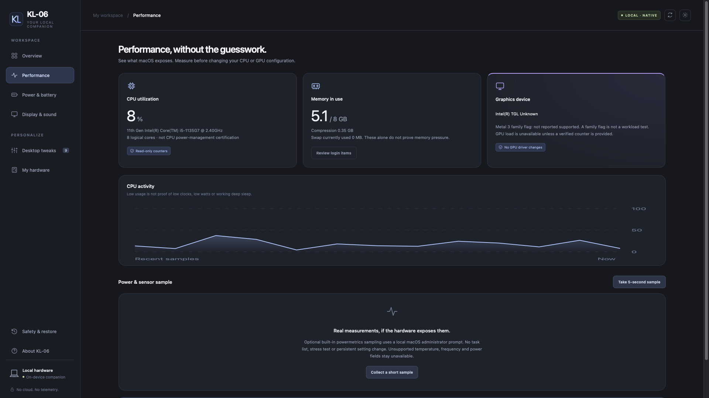

# ⚡ KL-06 Manager

### *Next-Generation Control Center for Modern Hackintosh Systems*

[-EA580C?style=for-the-badge&logo=asus&logoColor=white)](https://github.com/Kaushal-snap/KL-06-Manager)
[-0284C7?style=for-the-badge&logo=intel&logoColor=white)](https://github.com/Kaushal-snap/KL-06-Manager)

 

  <b>A lightweight, beautiful, and capability-aware macOS control companion.</b> 
  <i>Engineered specifically for Tiger Lake-U (Intel Core i5-1135G7) & Intel Iris Xe Graphics.</i>

---

[📥 Download KL-06.zip (Beta)](https://github.com/Kaushal-snap/KL-06-Manager/releases/tag/v0.2.1-beta.3) • [📖 Architecture](ARCHITECTURE.md) • [📋 Changelog](CHANGELOG.md) • [📊 Hardware Report](HARDWARE-REPORTS.md) • [🧪 Intake Specs](COMPONENT-REPORT.md)

---

 

## 🎯 Target Hardware & Verified Baseline

Tested and verified on physical hardware running **macOS Sequoia 15.8.3** (Build `24H241`, Darwin `24.6.0`, x86_64):

| Subsystem | Target Observation | Status Badge | Enforced Policy |
| :--- | :--- | :---: | :--- |
| **Graphics** | Intel Iris Xe (`0x9a49`), Metal 2, 1536 MB Dynamic VRAM |  | Custom WhateverXe 0.8.2 binary preserved (`9e18e609...`). |
| **Display** | 1920×1080 @ 60 Hz, 30-Bit Color Depth (ARGB2101010) |  | OLED / DPCD brightness & DSDT + SSDT-ASUS-FN intact. **HDR OFF** baseline preserved. |
| **Global Hotkey** | Physical `PrtSc` mapped to virtual **F13** (`keyCode 105`) |  | Show/Hide window toggle while running. Carbon `buffer.count` (`Int`) fix verified. |
| **Core Audio** | Built-in 44.1 kHz in / 96 kHz out (layout-id 7 / alc-layout-id 48) |  | Master output volume slider supported. Speakers, mic, & jack switching preserved. |
| **Desktop Tweaks**| 9 Reversible Dock, Finder, and Appearance settings |  | Atomic restore journal (`~/Library/Application Support/KL-Asus/Restore-v1.plist`). |
| **CPU Telemetry** | 11th Gen Intel Core i5-1135G7 @ 2.40 GHz (8 logical cores) |  | Real dynamic load & memory counters. No fake overclocking or CPUFriend tampering. |
| **Thermals & Fans**| `SMCSuperIO`: 0, `AsusSMC`: 0 (No WMI / EC fan RPM sensor) |  | **Strict Rule:** Fan controls honestly unavailable. No fake sliders or simulated curves. |
| **Battery Health** | Service Recommended, 314 cycles, 2236 / 3549 mAh (~63% ratio)|  | Real ACPI reporting surfaced honestly; no fake software calibration or charge limits. |

 

---

## 📸 Verified On-Device Screenshots

Native execution captured live on target hardware (`LOCAL • NATIVE` state):

| 1. Overview Dashboard | 2. Performance & Sampling |
| :---: | :---: |
|  |  |

| 3. Display & Sound Controls | 4. About KL-06 & Hotkey Status |
| :---: | :---: |
|  |  |

 

---

## 🚀 Key Highlights & Capabilities

- 🎨 **MyASUS-Inspired Modern Interface:** Sleek dark-mode aesthetic with real-time telemetry cards, color-coded status badges, and smooth gradient metrics.
- ⚡ **Zero Telemetry & Local-First:** No background daemons, no analytics tracking, no network calls (`connect-src 'none'`).
- 🛡️ **Preservation Invariants:**
  - Never touches your working EFI, OpenCore config, or boot arguments.
  - Retains bundle identity `app.klasus.controlcenter` and atomic restore journal.
  - Zero arbitrary kernel writes, MSR edits, or simulated fan controls.

 

---

## 📦 How to Test & Install (Beta)

1. Go to the [Releases Page](https://github.com/Kaushal-snap/KL-06-Manager/releases/tag/v0.2.1-beta.3) and download **`KL-06.zip`**.
2. Unzip `KL-06.zip` on your Mac.
3. Move `KL-06.app` to your `/Applications` folder or run it directly from `Downloads`.
4. Press **`PrtSc` (F13)** anytime to toggle the control center window.

> **Integrity Verification:**
> - **SHA-256:** `ee499aafcd36663e06cfe6c19f04f7d422c1f6b5c98fa8663c4eca9128c33317`
> - **Architecture:** `x86_64` (Mach-O 64-bit)

 

---

## 🔮 Roadmap Candidate: v0.3.0-beta.1 (Cirrus Theme)

Preparation and portable verification completed for the next candidate:
- 🌌 **Cirrus OLED-Dark Theme:** Refined independent dark & light aesthetics.
- 💨 **Read-Only AppleSMC Fan Reader:** Auditable C reader checking standard `FNum` and `F0Ac`/`F1Ac` keys (no fan writes or privileged helpers).
- 📈 **HWiNFO History Import:** Local Windows CSV history parser with unpadded-seconds timestamp handling for historical telemetry graphs.
- 🧪 **Portable Test Coverage:** 58 Node tests, 68 synthetic C assertions, and 12 package verification checks passed.
- *Status:* Awaiting native compilation & physical hardware test on owner's Mac (`UPDATE-KL-06.command`).

 

---

## 🔒 License & Copyright

**Copyright © 2026 Kaushal-snap. All Rights Reserved.**  
This is a proprietary companion utility. Unauthorized reproduction, decompilation, redistribution, or modification without explicit written consent is prohibited.
